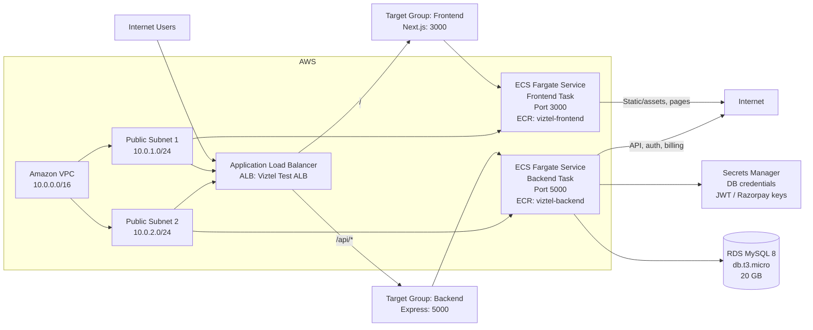

# Viztel Fiber AWS Deployment Guide (TEST | us-east-1)

> **Current deployment:** use [`aws-cli/deploy-test.sh`](./aws-cli/deploy-test.sh)
> and its [deployment notes](./aws-cli/README.md). Older manual examples below
> contain placeholders and should not be run as-is. The script does not create
> an RDS database or configure real secrets; the backend runs in demo mode
> without persistent storage.

This document outlines a target AWS architecture for the Viztel Fiber TEST environment using AWS Console and AWS CLI:

- Region: us-east-1
- Environment: TEST
- Frontend: Next.js
- Backend: Node.js Express
- Database: MySQL 8
- AWS container platform: ECS Fargate
- Image registry: ECR
- Load balancer: Application Load Balancer
- Secrets: AWS Secrets Manager
- Network: VPC with public subnets

## 1) AWS Architecture Diagram



## 2) AWS Console Setup Steps

### 2.1 Create the VPC

In the AWS Console:

1. Go to VPC.
2. Create VPC.
3. Name: `viztel-test-vpc`
4. IPv4 CIDR: `10.0.0.0/16`
5. Tenancy: Default
6. Create.

### 2.2 Create the subnets

Create these public subnets:

- Public Subnet 1: `10.0.1.0/24` in `us-east-1a`
- Public Subnet 2: `10.0.2.0/24` in `us-east-1b`

Enable:

- Auto-assign public IPv4 address: Yes

### 2.3 Internet Gateway and route table

1. Create an Internet Gateway: `viztel-test-igw`
2. Attach it to the VPC.
3. Create a public route table.
4. Add default route:
   - Destination: `0.0.0.0/0`
   - Target: Internet Gateway
5. Associate the public route table with both public subnets.

### 2.4 Create security groups

#### ALB Security Group
- Name: `viztel-alb-sg`
- Inbound:
  - 80/tcp from `0.0.0.0/0`
  - 443/tcp from `0.0.0.0/0`
- Outbound: all traffic

#### Frontend ECS Security Group
- Name: `viztel-frontend-sg`
- Inbound:
  - 3000/tcp from `viztel-alb-sg`
- Outbound: all traffic

#### Backend ECS Security Group
- Name: `viztel-backend-sg`
- Inbound:
  - 5000/tcp from `viztel-alb-sg`
- Outbound: all traffic

#### RDS Security Group
- Name: `viztel-rds-sg`
- Inbound:
  - 3306/tcp from `viztel-backend-sg`
- Outbound: all traffic

### 2.5 ECR repositories

Create two repositories:

- `viztel-frontend`
- `viztel-backend`

### 2.6 Secrets Manager

Create the following secrets, each as a plain string or JSON depending on design:

- `DB_HOST`
- `DB_USER`
- `DB_PASSWORD`
- `JWT_SECRET`
- `RAZORPAY_KEY`
- `RAZORPAY_SECRET`

Recommended format for a single JSON secret:

```json
{
  "DB_HOST": "viztel-test-db.xxxxxxxxxxxx.us-east-1.rds.amazonaws.com",
  "DB_USER": "admin",
  "DB_PASSWORD": "REPLACE_WITH_DB_PASSWORD",
  "JWT_SECRET": "REPLACE_WITH_LONG_RANDOM_SECRET",
  "RAZORPAY_KEY": "REPLACE_WITH_RAZORPAY_TEST_KEY",
  "RAZORPAY_SECRET": "REPLACE_WITH_RAZORPAY_TEST_SECRET"
}
```

The `aws-cli/03-secrets.sh` helper reads these values from environment
variables and uses `jq` to build the JSON secret; do not put real values in
this file or commit them.

Then reference individual keys in the ECS task definition by using Secrets Manager values.

### 2.7 Create RDS MySQL database

1. Go to RDS.
2. Click Create database.
3. Choose: `Standard Create`
4. Engine: `MySQL 8.0.x`
5. Template: `Free tier` or `Dev/Test` for TEST
6. DB instance identifier: `viztel-test-db`
7. Master username: `admin`
8. Master password: set a strong password
9. Instance type: `db.t3.micro`
10. Storage: `20 GB` General Purpose SSD
11. Availability & durability: Single-AZ for TEST
12. Public access: `No` (only backend tasks can reach it through the backend security group)
13. VPC: the same VPC created above
14. Subnet group: private/public-by-design not required if using public subnets and task networking; for TEST, keep it in the same VPC
15. VPC security group: `viztel-rds-sg`
16. Enable automatic backups and deletion protection if desired for TEST

### 2.8 Create ECS Cluster

1. Go to Elastic Container Service.
2. Create cluster: `viztel-test-cluster`
3. Choose `Networking only (Fargate)`
4. Create.

### 2.9 Create task definitions

Create two task definitions:

- `viztel-frontend-task`
  - CPU: `256`
  - Memory: `512`
  - Network mode: `awsvpc`
  - Compatibility: `Fargate`
  - Port mapping: `3000`

- `viztel-backend-task`
  - CPU: `512`
  - Memory: `1024`
  - Network mode: `awsvpc`
  - Compatibility: `Fargate`
  - Port mapping: `5000`

### 2.10 Create ALB

1. Go to EC2 > Load Balancers > Create Load Balancer.
2. Choose `Application Load Balancer`.
3. Name: `viztel-test-alb`
4. Scheme: `internet-facing`
5. VPC: `viztel-test-vpc`
6. Subnets: public subnet 1 and public subnet 2
7. Security group: `viztel-alb-sg`
8. Listeners:
   - Port 80 -> HTTP -> Forward to target group `viztel-frontend-tg`
   - Port 443 -> HTTPS -> Redirect to 443 or add cert later
9. Target groups:
   - `viztel-frontend-tg` for port 3000
   - `viztel-backend-tg` for port 5000
10. Add listener rule:
   - If `path pattern` matches `/api/*` => `viztel-backend-tg`
   - Else => `viztel-frontend-tg`

### 2.11 Create ECS services

Create service for frontend:

- Cluster: `viztel-test-cluster`
- Task definition: `viztel-frontend-task`
- Desired tasks: `1`
- Launch type: `Fargate`
- Subnets: both public subnets
- Security groups: `viztel-frontend-sg`
- Public IP: enabled
- Load balancer: attach `viztel-frontend-tg`

Create service for backend:

- Cluster: `viztel-test-cluster`
- Task definition: `viztel-backend-task`
- Desired tasks: `1`
- Launch type: `Fargate`
- Subnets: both public subnets
- Security groups: `viztel-backend-sg`
- Public IP: enabled
- Load balancer: attach `viztel-backend-tg`

### 2.12 Validation

1. Open the ALB DNS name in a browser.
2. Confirm the frontend loads at `/`.
3. Confirm payment and login APIs hit `/api/*`.
4. Check task logs and configure CloudWatch.

## 3) ECR Commands

```bash
export AWS_REGION=us-east-1
export AWS_ACCOUNT_ID=$(aws sts get-caller-identity --query Account --output text)

aws ecr create-repository \
  --repository-name viztel-frontend \
  --region $AWS_REGION \
  --image-scanning-configuration scanOnPush=true

aws ecr create-repository \
  --repository-name viztel-backend \
  --region $AWS_REGION \
  --image-scanning-configuration scanOnPush=true

aws ecr get-login-password --region $AWS_REGION | \
  docker login --username AWS --password-stdin ${AWS_ACCOUNT_ID}.dkr.ecr.${AWS_REGION}.amazonaws.com
```

### Build and push images

```bash
docker buildx build \
  --platform linux/amd64 \
  -f docker/Dockerfile.frontend \
  -t viztel-frontend:latest \
  .

docker tag viztel-frontend:latest \
  ${AWS_ACCOUNT_ID}.dkr.ecr.${AWS_REGION}.amazonaws.com/viztel-frontend:latest

docker push ${AWS_ACCOUNT_ID}.dkr.ecr.${AWS_REGION}.amazonaws.com/viztel-frontend:latest

# backend

docker buildx build \
  --platform linux/amd64 \
  -f docker/Dockerfile.backend \
  -t viztel-backend:latest \
  .

docker tag viztel-backend:latest \
  ${AWS_ACCOUNT_ID}.dkr.ecr.${AWS_REGION}.amazonaws.com/viztel-backend:latest

docker push ${AWS_ACCOUNT_ID}.dkr.ecr.${AWS_REGION}.amazonaws.com/viztel-backend:latest
```

> For MacBook M1/M2/M3 laptops, use `docker buildx` with `--platform linux/amd64` to produce ECS-compatible images.

## 4) Dockerfiles

See the sample files included in this folder:

- `docker/Dockerfile.frontend`
- `docker/Dockerfile.backend`

### Frontend Dockerfile

```dockerfile
FROM node:20-alpine AS deps
WORKDIR /app
COPY package*.json ./
RUN npm ci --only=production

FROM node:20-alpine AS builder
WORKDIR /app
COPY . .
RUN npm ci && npm run build

FROM node:20-alpine AS runner
WORKDIR /app
ENV NODE_ENV=production
ENV PORT=3000
ENV NEXT_TELEMETRY_DISABLED=1
COPY --from=builder /app/public ./public
COPY --from=builder /app/.next ./.next
COPY --from=builder /app/package.json ./package.json
COPY --from=builder /app/node_modules ./node_modules
EXPOSE 3000
CMD ["npm", "run", "start", "--", "--hostname", "0.0.0.0", "--port", "3000"]
```

### Backend Dockerfile

```dockerfile
FROM node:20-alpine
WORKDIR /app
COPY package*.json ./
RUN npm ci --only=production
COPY . .
ENV NODE_ENV=production
ENV PORT=5000
EXPOSE 5000
CMD ["node", "server.js"]
```

## 5) ECS Task Definition JSON

Sample task definitions are stored here:

- `ecs/frontend-task-definition.json`
- `ecs/backend-task-definition.json`

### Frontend task definition example

```json
{
  "family": "viztel-frontend-task",
  "networkMode": "awsvpc",
  "requiresCompatibilities": ["FARGATE"],
  "cpu": "256",
  "memory": "512",
  "executionRoleArn": "arn:aws:iam::<ACCOUNT_ID>:role/ecsTaskExecutionRole",
  "taskRoleArn": "arn:aws:iam::<ACCOUNT_ID>:role/viztel-ecs-task-role",
  "containerDefinitions": [
    {
      "name": "viztel-frontend",
      "image": "<ACCOUNT_ID>.dkr.ecr.us-east-1.amazonaws.com/viztel-frontend:latest",
      "essential": true,
      "portMappings": [
        {
          "containerPort": 3000,
          "hostPort": 3000,
          "protocol": "tcp"
        }
      ],
      "environment": [
        { "name": "PORT", "value": "3000" },
        { "name": "NODE_ENV", "value": "test" },
        { "name": "NEXT_PUBLIC_API_BASE_URL", "value": "/api" }
      ],
      "logConfiguration": {
        "logDriver": "awslogs",
        "options": {
          "awslogs-group": "/ecs/viztel-frontend",
          "awslogs-region": "us-east-1",
          "awslogs-stream-prefix": "ecs"
        }
      }
    }
  ]
}
```

### Backend task definition example

```json
{
  "family": "viztel-backend-task",
  "networkMode": "awsvpc",
  "requiresCompatibilities": ["FARGATE"],
  "cpu": "512",
  "memory": "1024",
  "executionRoleArn": "arn:aws:iam::<ACCOUNT_ID>:role/ecsTaskExecutionRole",
  "taskRoleArn": "arn:aws:iam::<ACCOUNT_ID>:role/viztel-ecs-task-role",
  "containerDefinitions": [
    {
      "name": "viztel-backend",
      "image": "<ACCOUNT_ID>.dkr.ecr.us-east-1.amazonaws.com/viztel-backend:latest",
      "essential": true,
      "portMappings": [
        {
          "containerPort": 5000,
          "hostPort": 5000,
          "protocol": "tcp"
        }
      ],
      "environment": [
        { "name": "PORT", "value": "5000" },
        { "name": "NODE_ENV", "value": "test" },
        { "name": "DB_HOST", "value": "viztel-test-db.xxxxxxxxxx.us-east-1.rds.amazonaws.com" }
      ],
      "secrets": [
        { "name": "DB_USER", "valueFrom": "arn:aws:secretsmanager:us-east-1:<ACCOUNT_ID>:secret:DB_USER-xxxx:DB_USER::" },
        { "name": "DB_PASSWORD", "valueFrom": "arn:aws:secretsmanager:us-east-1:<ACCOUNT_ID>:secret:DB_USER-xxxx:DB_PASSWORD::" },
        { "name": "JWT_SECRET", "valueFrom": "arn:aws:secretsmanager:us-east-1:<ACCOUNT_ID>:secret:DB_USER-xxxx:JWT_SECRET::" },
        { "name": "RAZORPAY_KEY", "valueFrom": "arn:aws:secretsmanager:us-east-1:<ACCOUNT_ID>:secret:DB_USER-xxxx:RAZORPAY_KEY::" },
        { "name": "RAZORPAY_SECRET", "valueFrom": "arn:aws:secretsmanager:us-east-1:<ACCOUNT_ID>:secret:DB_USER-xxxx:RAZORPAY_SECRET::" }
      ],
      "logConfiguration": {
        "logDriver": "awslogs",
        "options": {
          "awslogs-group": "/ecs/viztel-backend",
          "awslogs-region": "us-east-1",
          "awslogs-stream-prefix": "ecs"
        }
      }
    }
  ]
}
```

### Register the task definitions

```bash
aws ecs register-task-definition --cli-input-json file://ecs/frontend-task-definition.json --region us-east-1
aws ecs register-task-definition --cli-input-json file://ecs/backend-task-definition.json --region us-east-1
```

## 6) Security Groups

```bash
# Create ALB security group
aws ec2 create-security-group \
  --group-name viztel-alb-sg \
  --description "ALB security group" \
  --vpc-id vpc-xxxxxxxxxxxxxxxxx \
  --region us-east-1

aws ec2 authorize-security-group-ingress \
  --group-id sg-xxxxxxxxxxxxxxxxx \
  --protocol tcp --port 80 --cidr 0.0.0.0/0 \
  --region us-east-1

aws ec2 authorize-security-group-ingress \
  --group-id sg-xxxxxxxxxxxxxxxxx \
  --protocol tcp --port 443 --cidr 0.0.0.0/0 \
  --region us-east-1

# Frontend ECS security group
aws ec2 create-security-group \
  --group-name viztel-frontend-sg \
  --description "Frontend ECS security group" \
  --vpc-id vpc-xxxxxxxxxxxxxxxxx \
  --region us-east-1

aws ec2 authorize-security-group-ingress \
  --group-id sg-xxxxxxxxxxxxxxxxx \
  --protocol tcp --port 3000 \
  --source-group sg-xxxxxxxxxxxxxxxxx \
  --region us-east-1

# Backend ECS security group
aws ec2 create-security-group \
  --group-name viztel-backend-sg \
  --description "Backend ECS security group" \
  --vpc-id vpc-xxxxxxxxxxxxxxxxx \
  --region us-east-1

aws ec2 authorize-security-group-ingress \
  --group-id sg-xxxxxxxxxxxxxxxxx \
  --protocol tcp --port 5000 \
  --source-group sg-xxxxxxxxxxxxxxxxx \
  --region us-east-1

# RDS security group
aws ec2 create-security-group \
  --group-name viztel-rds-sg \
  --description "RDS security group" \
  --vpc-id vpc-xxxxxxxxxxxxxxxxx \
  --region us-east-1

aws ec2 authorize-security-group-ingress \
  --group-id sg-xxxxxxxxxxxxxxxxx \
  --protocol tcp --port 3306 \
  --source-group sg-xxxxxxxxxxxxxxxxx \
  --region us-east-1
```

## 7) ALB Configuration

### Target groups

- `viztel-frontend-tg`
  - Protocol: HTTP
  - Port: 3000
  - Target type: ip
  - Health check: `/`

- `viztel-backend-tg`
  - Protocol: HTTP
  - Port: 5000
  - Target type: ip
  - Health check: `/health` or `/api/health`

### Listener rules

- Port 80 (HTTP): default action -> `viztel-frontend-tg`
- Add rule: `Path pattern /api/*` -> `viztel-backend-tg`
- Keep `/` and static frontend routes on frontend target group

### Example AWS CLI pattern

```bash
aws elbv2 create-load-balancer \
  --name viztel-test-alb \
  --subnets subnet-xxxxxxxxxxxxxxxxx subnet-xxxxxxxxxxxxxxxxx \
  --security-groups sg-xxxxxxxxxxxxxxxxx \
  --scheme internet-facing \
  --type application \
  --region us-east-1
```

## 8) RDS Configuration

### Recommended settings

- Engine: `MySQL 8.0`
- DB instance class: `db.t3.micro`
- Storage: `20 GiB`
- Storage type: `gp2`
- Multi-AZ: `No` for TEST
- Public access: `No`
- Backup retention: `7 days`
- Deletion protection: `No` for TEST

### Example AWS CLI create-db-instance

```bash
: "${DB_PASSWORD:?Set DB_PASSWORD before running this command}"

aws rds create-db-instance \
  --db-instance-identifier viztel-test-db \
  --db-name viztel \
  --db-instance-class db.t3.micro \
  --engine mysql \
  --engine-version 8.0.37 \
  --allocated-storage 20 \
  --storage-type gp2 \
  --master-username admin \
  --master-user-password "$DB_PASSWORD" \
  --db-subnet-group-name viztel-db-subnet-group \
  --vpc-security-group-ids sg-xxxxxxxxxxxxxxxxx \
  --backup-retention-period 7 \
  --region us-east-1
```

## 9) Secrets Manager Setup

### AWS Console

1. Go to Secrets Manager.
2. Click Store a new secret.
3. Choose `Other type of secret`.
4. Add key/value pairs:
   - `DB_HOST`
   - `DB_USER`
   - `DB_PASSWORD`
   - `JWT_SECRET`
   - `RAZORPAY_KEY`
   - `RAZORPAY_SECRET`
5. Name: `viztel-test-secrets`
6. Add encryption key (AWS managed key or customer CMK).
7. Save.

### AWS CLI

```bash
aws secretsmanager create-secret \
  --name viztel-test-secrets \
  --secret-string '{"DB_HOST":"viztel-test-db.xxxxxxxxxx.us-east-1.rds.amazonaws.com","DB_USER":"admin","DB_PASSWORD":"REPLACE_WITH_DB_PASSWORD","JWT_SECRET":"REPLACE_WITH_LONG_RANDOM_SECRET","RAZORPAY_KEY":"REPLACE_WITH_RAZORPAY_TEST_KEY","RAZORPAY_SECRET":"REPLACE_WITH_RAZORPAY_TEST_SECRET"}' \
  --region us-east-1
```

## 10) macOS Deployment Commands

These commands are designed for MacBook M1/M2/M3 users.

```bash
export AWS_REGION=us-east-1
export AWS_ACCOUNT_ID=$(aws sts get-caller-identity --query Account --output text)

# Login to ECR
aws ecr get-login-password --region $AWS_REGION | \
  docker login --username AWS --password-stdin ${AWS_ACCOUNT_ID}.dkr.ecr.${AWS_REGION}.amazonaws.com

# Build and push frontend
cd ~/path/to/viztel-project

docker buildx build \
  --platform linux/amd64 \
  -f docker/Dockerfile.frontend \
  -t viztel-frontend:latest \
  .

docker tag viztel-frontend:latest \
  ${AWS_ACCOUNT_ID}.dkr.ecr.${AWS_REGION}.amazonaws.com/viztel-frontend:latest

docker push ${AWS_ACCOUNT_ID}.dkr.ecr.${AWS_REGION}.amazonaws.com/viztel-frontend:latest

# Build and push backend

docker buildx build \
  --platform linux/amd64 \
  -f docker/Dockerfile.backend \
  -t viztel-backend:latest \
  .

docker tag viztel-backend:latest \
  ${AWS_ACCOUNT_ID}.dkr.ecr.${AWS_REGION}.amazonaws.com/viztel-backend:latest

docker push ${AWS_ACCOUNT_ID}.dkr.ecr.${AWS_REGION}.amazonaws.com/viztel-backend:latest

# Update ECS services to use new images
aws ecs update-service \
  --cluster viztel-test-cluster \
  --service viztel-frontend-service \
  --force-new-deployment \
  --region $AWS_REGION

aws ecs update-service \
  --cluster viztel-test-cluster \
  --service viztel-backend-service \
  --force-new-deployment \
  --region $AWS_REGION
```

## 11) Cost Estimate for us-east-1

Estimated monthly spend for a small TEST environment with 2 Fargate tasks + 1 RDS instance + ALB + ECR + CloudWatch + Secrets Manager:

| AWS Service | Estimated Monthly Cost |
| --- | ---: |
| Application Load Balancer | $20-30 |
| ECS Fargate (2 tasks, small footprint) | $15-35 |
| RDS MySQL db.t3.micro | $15-25 |
| ECR storage and pulls | $1-3 |
| Secrets Manager | $0.50-2 |
| CloudWatch Logs | $1-5 |
| Total | $55-100 |

This is a reasonable estimate for a TEST environment in `us-east-1` with 24x7 uptime.

## 12) Troubleshooting Guide

### Frontend not loading

Check:

- ALB health checks
- Target group is healthy
- ECS service task status is `RUNNING`
- Container logs in CloudWatch

### Backend API returns 502/504

Check:

- Backend security group allows ALB inbound 5000
- Container listening on port 5000
- RDS connectivity and DB credentials
- Secret values are correctly loaded into the task

### Database connection issues

Check:

- RDS endpoint is correct in `DB_HOST`
- Security group allows port 3306 from the backend ECS security group
- MySQL user has correct permissions
- The backend task can resolve DNS and talk to RDS

### Secrets not resolving

Check:

- ECS task execution role has `secretsmanager:GetSecretValue`
- ARN references correct secret and key names
- Secret names match exactly in the task definition

### ALB path routing issues

Check:

- Listener rule matches `/api/*`
- Backend target group uses port 5000
- Frontend and backend tasks are registered to correct target groups

### Mac M1/M2/M3 Docker build issues

Use:

```bash
docker buildx build --platform linux/amd64 ...
```

This ensures the image matches the Fargate architecture and avoids architecture mismatch errors.

## Final Notes

This design is intentionally aligned with the exact AWS stack you requested:

- AWS Console only + AWS CLI
- No Terraform
- No CI/CD
- ECS Fargate
- ECR for images
- ALB for ingress
- RDS MySQL
- Secrets Manager
- `us-east-1` + `TEST`
- Public subnet architecture with path-based routing

The environment is suitable for a broadband ISP portal with customer login, broadband plans, online payments, and an admin dashboard.
